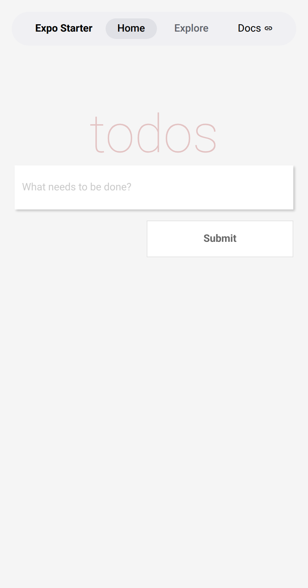
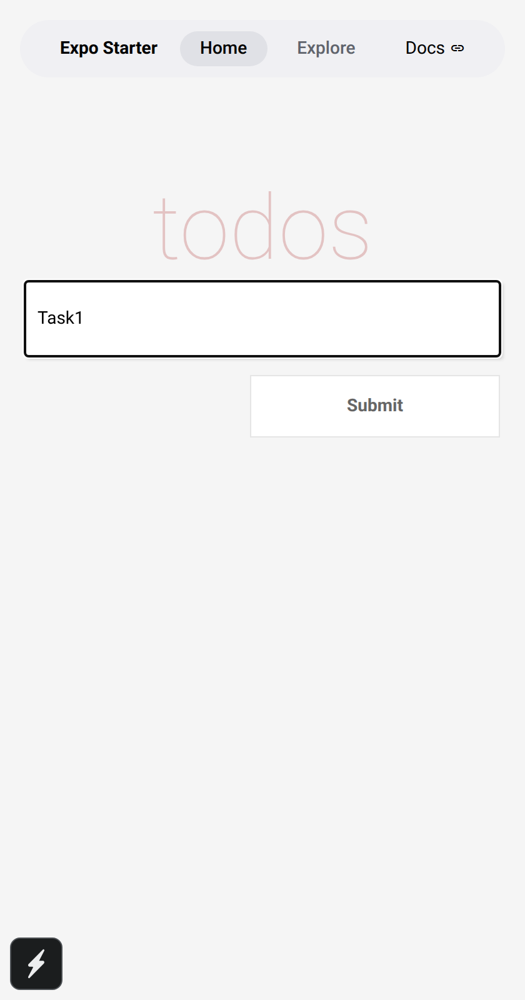
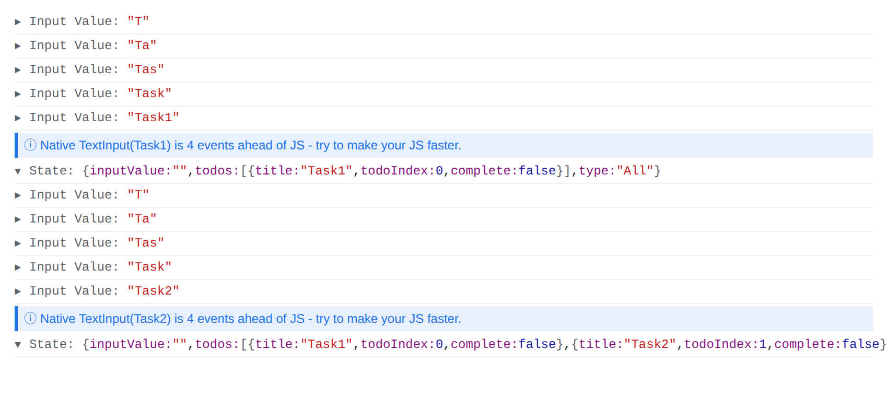

# Input

The application accepts user input through an interactive `TextInput` field and touch interactions on the custom `Button` component. Users enter task descriptions via the on-screen keyboard, triggering character-by-character text changes. Pressing the "Submit" touchable highlight triggers a tap event, and vertical drag gestures enable fluid scrolling within the `ScrollView` container.

# Process

The application processes data using component state within the top-level `App` class. Every keystroke invokes `inputChange`, updating `this.state.inputValue` and logging the entered text to the console. When the user taps the Submit button, `submitTodo` validates that the input is non-empty. It constructs a new todo object containing the entered title, an incremented `todoIndex`, and a `complete: false` flag. The method appends this object to the `todos` state array, clears `inputValue`, and logs the resulting application state via `this.setState`.

# Output

The visual output presents a clean header displaying "todos", a styled text input with shadow elevation and placeholder text, and a right-aligned Submit button with press feedback. The terminal and browser console display live logs of typed input values alongside the serialized state object upon each submission.

---

## Submission Screenshots

| Screenshot | Description | Preview |
| :--- | :--- | :--- |
| **`pe03_part1_ui.png`** | Application UI displaying Heading, Input field, and Submit button |  |
| **`pe03_part1_typed.png`** | Active user typing in the controlled TextInput component |  |
| **`pe03_part1_console.png`** | Console output capturing `Input Value:` logs and submitted `State:` object |  |

---

## Technical Implementation Details

- **Component Decomposition**:
  - `Heading.js`: Stateless presentational header component.
  - `Input.js`: Controlled text input with drop-shadow container.
  - `Button.js`: TouchableHighlight submission trigger with hover/press feedback.
  - `App.js`: Top-level state container managing `inputValue`, `todos` array, and `type` filter.
- **State Management & Unidirectional Data Flow**:
  - `inputChange(inputValue)`: Captures text change events, logs to console, and syncs `inputValue` state.
  - `submitTodo()`: Validates input string against whitespace regex (`/^\s*$/`), creates immutable todo item with unique incrementing `todoIndex`, appends item to `todos` array, resets `inputValue` to empty string, and prints state to console.
