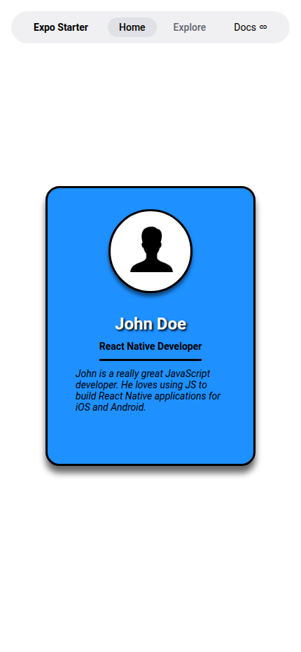
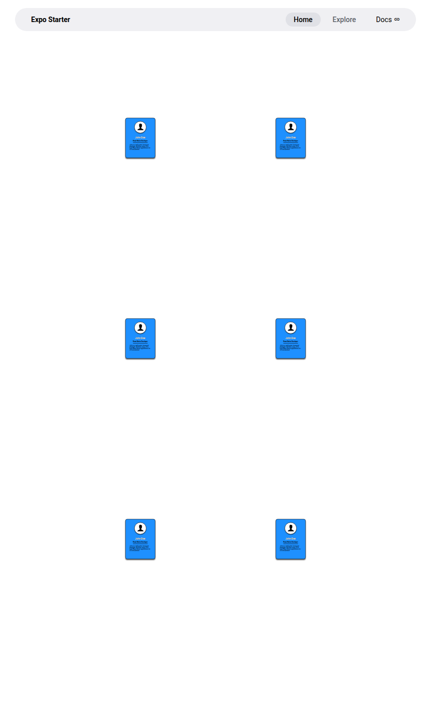
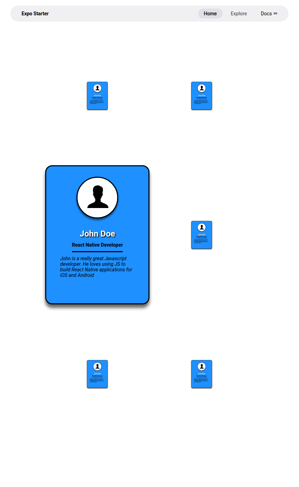

# Input

In Part 1, the Profile Card functions as a presentational component without direct text entry. In Part 2, the application captures user touch and tap interactions through React Native `TouchableHighlight` wrappers enclosing each profile card in the gallery grid. Users tap on any card thumbnail to trigger expansion and collapse toggles, alongside vertical swipe gestures handled across the viewport container.

# Process

In Part 1, React Native processes styling declarations through `StyleSheet.create`, resolving box model properties (`borderWidth`, `borderRadius`, `paddingTop`, `marginTop`), rendering typography styles (`fontSize`, `fontWeight`, `fontStyle: 'italic'`), and applying platform-specific drop shadows (`Platform.select`) and text shadows (`textShadowColor`, `textShadowOffset`, `textShadowRadius`). In Part 2, the top-level `App` component processes state transitions across an array of profile objects. When a tap event triggers `handleProfileCardPress(index)`, the method inverts the item's `showThumbnail` boolean flag. React reconciles state immutably using `immutability-helper`, dynamically appending `styles.cardThumbnail` (`transform: [{ scale: 0.2 }]`) to shrink the card or omitting it to expand the card to full size (`300x400`) within the flexbox grid (`flexDirection: 'row'`, `flexWrap: 'wrap'`).

# Output

Part 1 renders a centered blue profile card with a circular avatar frame, bold user name with text shadow, underlined occupation title, and an italicized biography. Part 2 renders a responsive 3×2 gallery grid displaying 6 thumbnail cards that dynamically expand into full-sized, detailed profile cards upon click interaction while neighboring thumbnails adapt within the flexbox layout.

---

## Submission Screenshots

| Screenshot | Description | Preview |
| :--- | :--- | :--- |
| **`pe04_part1_profile_card.png`** | **Part 1**: Finished Profile Card component with styled text (name, occupation underline, italic bio) and drop shadows |  |
| **`pe04_part2_gallery_thumbnails.png`** | **Part 2 (Before Expand)**: 6 profile cards arranged in a 3×2 flexbox gallery collapsed into thumbnails (`showThumbnail: true`) |  |
| **`pe04_part2_card_expanded.png`** | **Part 2 (When Clicked on a Thumbnail)**: Selected card (Row 2, Column 1) expanded to full dimensions displaying complete profile information |  |

---

## Technical Implementation Details

### Part 1: Styling Text Components (*React Native in Action*, Section 4.3)
- **Directory**: `PE04/Part1`
- **Component File**: [`PE04/Part1/src/app/App.js`](Part1/src/app/App.js)
- **Features Implemented**:
  - `cardContainer`: 300×400 card with `backgroundColor: 'dodgerblue'`, `borderRadius: 20`, black border, and cross-platform drop shadow (`Platform.select` with iOS `shadowColor`/`shadowOffset`/`shadowOpacity` and Android `elevation`).
  - `cardImageContainer` & `cardImage`: Circular frame (`width: 120, height: 120, borderRadius: 60`) centering the user avatar (`assets/images/user.png`) with drop shadow elevation.
  - `cardName`: Bold white text (`fontSize: 24`, `marginTop: 30`) with drop shadow (`textShadowColor: 'black'`, `textShadowOffset: { width: 2, height: 2 }`, `textShadowRadius: 3`).
  - `cardOccupationContainer` & `cardOccupation`: Underlined title block (`borderBottomWidth: 3`, `borderColor: 'black'`) displaying `"React Native Developer"`.
  - `cardDescription`: Centered italic bio paragraph (`fontStyle: 'italic'`, `marginHorizontal: 40`, `marginBottom: 10`).

### Part 2: Flexbox Gallery & Thumbnail Toggle (*React Native in Action*, Section 5.3)
- **Directory**: `PE04/Part2`
- **Component File**: [`PE04/Part2/src/app/App.js`](Part2/src/app/App.js)
- **Features Implemented**:
  - `ProfileCard` Component: Reusable presentational component with `PropTypes` validation accepting `image`, `name`, `occupation`, `description`, `showThumbnail`, and `onPress`.
  - Dynamic Transformations: Dynamically pushes `styles.cardThumbnail` (`transform: [{ scale: 0.2 }]`) when `showThumbnail` is true, scaling down the entire card structure uniformly.
  - Flexbox Layout: Multi-column container using `flexDirection: 'row'`, `flexWrap: 'wrap'`, `justifyContent: 'center'`, `alignItems: 'center'`, and `marginTop: 75` to arrange the 6 cards in a responsive grid.
  - Interactive State Management: `handleProfileCardPress(index)` inverts the targeted card's `showThumbnail` state property immutably via `immutability-helper` (`update`), enabling users to click cards to toggle between miniature thumbnail and expanded view.
